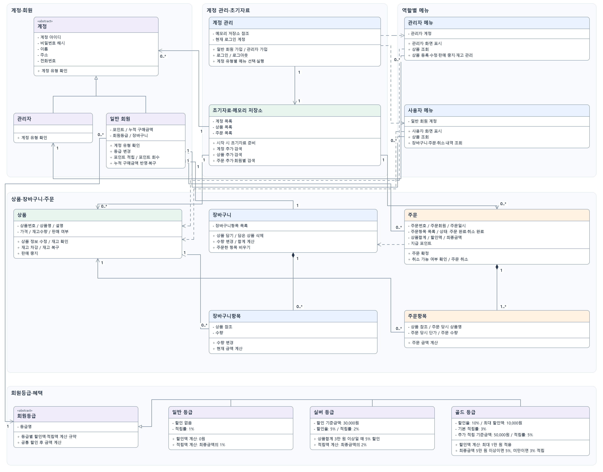

# 쇼핑몰 상품·주문 관리 시스템

2026-2 객체지향프로그래밍[B] 팀 프로젝트

## 1. 프로젝트 개요

- **목적:** 상품·장바구니·주문 객체의 협력으로 재고와 회원 혜택을 처리하고 OOP 4대 원리를 적용합니다.
- **기능:** 일반 회원·관리자 회원가입, 로그인·로그아웃, 관리자의 상품 등록·수정·판매 중지·재고 관리, 일반 회원의 상품 조회·장바구니·주문·전체 취소, 일반·실버·골드별 할인·포인트 적립
- **범위:** 상품 종류별 하위 클래스, 쿠폰, 실제 결제·환불 연동, 배송 처리, 부분 취소, 포인트 사용, 자동 승급은 현재 범위에서 제외합니다.
- **상태:** 2026-11-17 기준 설계 단계입니다. 팀에서 직접 코딩할 예정이며, 기능 실행·테스트 완료를 의미하지 않습니다.

## 2. 팀 구성

| 이름 | 학번 | 담당 영역 |
|---|---|---|
| 나건희 (팀장) | 2571122 | 상품·장바구니·주문·메모리 자료 |
| 최동근 | 1971099 | 계정·회원등급·역할별 메뉴 |

### 역할 분담 이유
- 기능 영역을 나눠 구현하되, 공동 검토를 통해 두 팀원 모두 OOP 4대 원리와 전체 실행 흐름을 설명할 수 있도록 준비
- 예외 처리와 상태 전이가 많은 주문·취소 흐름은 핵심 로직이라 팀장이 담당
- 회원·등급 혜택은 등급 추상 클래스와 하위 클래스의 계산을 담당하고 화면과 연결

### 함께 맞출 기능 규약

계정 관리가 메모리 자료를 사용하고, 메뉴가 같은 상품·주문 목록을 전달받아 사용하도록 연결 방식을 합의합니다. 주문 과정은 회원의 등급 계산과 포인트 적립을 연결합니다. 상세 메서드명과 매개변수는 팀에서 직접 코딩하면서 정합니다.

### 주차별 계획

교수님의 주차별 목표에 맞춰 팀 작업을 배치합니다. 구현 완료를 표시한 표가 아닌 앞으로의 진행 계획입니다.

| 주차·기간 | 우리 팀이 진행할 작업 | 담당·확인 기준 |
|---|---|---|
| 12주차 · 11/16~11/22 | 상품·회원 기본 클래스 우선 구현. 상품 상태와 계정 공통 정보·관리자·일반 회원 구분을 검토하고, 작성한 코드에 SOLID 원칙을 참고하여 필요한 설계 개선 진행 | 나건희: 상품 / 최동근: 계정·관리자·일반 회원 기본 구조. 공동으로 클래스 책임·관계 검토. 장바구니·주문·메뉴 구현은 다음 단계 |
| 13주차 · 11/23~11/29 | 회원가입·로그인, 장바구니, 주문·취소, 등급별 혜택, 역할별 메뉴 구현·연결로 핵심 기능 완성 및 중간 점검 | 담당 영역별 구현 후 전체 흐름 연결. 관리자 상품 관리와 회원 주문·취소 확인 |
| 14주차 · 11/30~12/06 | 정상·예외 상황 테스트, 오류 수정, UML·README를 실제 코드에 맞춰 정리하고 발표 PDF·시연 준비 | 공동 검증. 서로의 코드 설명, 수정·재실행 연습 |
| 15주차 · 12/07~12/13 | 최종 결과물 제출, 프로그램 시연, 주요 코드·OOP 설계 이유 설명 및 질의응답 | 제출본 재실행, 팀원별 설명·수정 대응 |

### 협업 규칙
- `main`에 직접 푸시하지 않는다. **브랜치 → PR → 상대방 리뷰 → merge**
  - 브랜치 이름: `feat/기능명` (예: `feat/product`, `feat/discount`), 버그 수정은 `fix/내용`
  - 커밋 메시지: `[기능] 내용` 형식 (예: `[상품] 재고 검사 추가`)
- 할 일은 **Issues**에 등록하고 담당자 지정, PR에서 `close #이슈번호`로 연결
- 회의 결정 사항은 **Discussions**에 주차별로 기록 (날짜 / 논의 내용 / 결정과 이유 / 다음 할 일)

## 3. 개발 환경

- 개발 언어: Java 계획
- JDK 버전·개발 도구: 팀에서 확정 후 기록
- 실행 형태: 콘솔로 시작하는 방안
- 외부 라이브러리: 현재 확정된 런타임 의존성 없음

개발 환경은 결정한 버전과 실제 설치·실행 결과를 함께 갱신합니다.

## 4. 프로젝트 폴더 구조

폴더는 최소화하고 src 바로 아래에 빈 Java 파일을 준비했습니다. 아래 파일은 모두 **내용이 없는 0바이트 파일**이며 프로그램 구현은 팀에서 직접 진행합니다.

```text
OOP_Teamproject/
├─ README.md
├─ run.bat
├─ src/
│  ├─ Main.java
│  ├─ Account.java
│  ├─ Admin.java
│  ├─ Member.java
│  ├─ AccountManager.java
│  ├─ InMemoryStore.java
│  ├─ AdminMenu.java
│  ├─ MemberMenu.java
│  ├─ Product.java
│  ├─ Cart.java
│  ├─ CartItem.java
│  ├─ Order.java
│  ├─ OrderItem.java
│  ├─ MembershipGrade.java
│  ├─ NormalGrade.java
│  ├─ SilverGrade.java
│  └─ GoldGrade.java
└─ docs/
   ├─ shopping-class-diagram.png
   └─ notion-project-overview.md
```

- Main.java는 실행 진입점이며 별도 업무 클래스로 UML에 추가하지 않았습니다.
- 계정 관리: Account·Admin·Member·AccountManager
- 초기자료와 목록: InMemoryStore
- 역할별 메뉴: AdminMenu·MemberMenu
- 상품·구매: Product·Cart·CartItem·Order·OrderItem
- 등급: MembershipGrade·NormalGrade·SilverGrade·GoldGrade
- 메뉴 인터페이스 파일과 별도 주문상태 파일은 만들지 않습니다. 주문상태는 주문 내부에서 관리합니다.
- 이전의 빈 패키지·테스트 폴더와 불필요한 .gitkeep은 제거했습니다. 테스트 파일과 추가 패키지는 실제 필요가 생기면 작성합니다.

## 5. 실행 방법

현재 src의 Java 파일은 비어 있어 실행 가능한 프로그램은 아닙니다. run.bat는 평면 src 구조에서 Main을 실행하도록 정리한 준비용 스크립트입니다.

팀에서 코드를 작성한 후 JDK 버전과 실행 환경을 확정하고 다음 순서로 확인합니다.

```text
javac -encoding UTF-8 -d out src/*.java
java -cp out Main
```

Windows에서는 run.bat를 사용할 수 있습니다. 위 명령의 실제 실행·기능 동작 검증은 구현 후 진행합니다. 현재 테스트 통과나 실행 완료로 표시하지 않습니다.

## 6. 클래스 다이어그램과 관계 설계

> 팀의 설계와 논의를 반영한 구현 전 설계안입니다. 그림은 한글 정보·기능 설명 위주로 작성하고 괄호·자료형 등 코드 서명은 생략했습니다. 실제 코딩은 영어 식별자를 사용해 팀에서 직접 진행합니다.



### 6.1 유형별 클래스와 생성 이유

#### 계정·회원

| 클래스 | 보관 정보 | 담당 기능과 분리 이유 |
|---|---|---|
| 계정 | 아이디, 비밀번호 해시, 이름, 주소, 전화번호 | 관리자·일반 회원이 공유하는 개인정보를 부모에서 관리하는 추상 클래스 |
| 관리자 | 계정의 공통 정보 상속 | 관리 전용 계정 유형을 나타냄. 등급·포인트·장바구니는 가지지 않음 |
| 일반 회원 | 공통 정보와 포인트, 누적 구매금액, 회원등급, 장바구니 | 구매 혜택과 회원 소유 구매 정보를 관리 |

계정은 개인정보의 공통 관리 주체입니다. 주소·전화번호는 관리자와 일반 회원 모두 가지며, 가입일은 현재 기능에서 사용하지 않아 제외했습니다. 계정 유형과 혜택 등급은 다릅니다. 일반 회원도 실버·골드 등급일 수 있습니다.

#### 계정 관리·초기자료

| 클래스 | 담당 기능 | 생성 이유 |
|---|---|---|
| 계정 관리 | 일반 회원·관리자 가입, 로그인·로그아웃, 현재 계정 관리, 역할별 메뉴 선택·실행 | 시작·인증 흐름을 한곳에서 처리하되 상품·주문 목록까지 계정 관리 책임에 섞지 않음 |
| 초기자료·메모리 저장소 | 시작 시 초기자료 준비, 계정·상품·주문 목록 보관, 추가·검색 | 여러 메뉴가 같은 자료를 사용하고 실행 중 생성한 주문을 다시 찾도록 보관 주체를 명확히 함 |

실제 DB 연결은 하지 않습니다. 데이터는 메모리에만 존재하며 종료 후 다시 실행하면 초기자료 상태로 시작합니다. 파일 저장·데이터베이스 영구 저장은 이번 범위에서 제외합니다. 초기자료를 준비하는 기능과 실행 중 변경된 자료 보관을 한 저장소로 묶어 불필요한 클래스를 늘리지 않습니다.

#### 역할별 메뉴

- **관리자 메뉴:** 관리자 화면 표시, 상품 조회·등록·수정·판매 중지·재고 관리 입력을 처리합니다.
- **사용자 메뉴:** 일반 회원 화면 표시, 상품 조회·장바구니·주문·취소·내역 조회 입력을 처리합니다.
- **분리 이유:** 두 계정이 사용할 기능과 입력 흐름이 다릅니다. 화면을 나누되 상품 상태 변경, 주문 처리, 할인 계산 규칙은 업무 객체에 맡깁니다.
- **인터페이스 판단:** 메뉴 인터페이스는 두지 않습니다. 현재 두 메뉴를 공통 타입으로 다룰 실질적인 필요가 크지 않아 독립된 클래스로 유지합니다. 공통 상품 조회도 인터페이스를 반드시 요구하는 근거는 아닙니다.
- 메뉴는 필요한 자료를 전달받아 사용합니다. 그림의 점선 상품 연결은 상품 조회·변경 기능을 사용하는 의존을 나타냅니다.
- 계정 관리에서 각 메뉴로 향하는 점선은 계정 유형에 맞는 메뉴를 선택·실행하는 의존입니다. 두 메뉴의 기능이 같다는 뜻이 아닙니다.

#### 상품·장바구니·주문

| 클래스 | 보관 정보·기능 | 생성 이유 |
|---|---|---|
| 상품 | 상품번호·이름·설명·가격·재고·판매 여부, 정보 수정·재고 검사·차감·복구 | 모든 메뉴·항목에서 같은 판매 대상과 재고를 참조 |
| 장바구니 | 항목 목록, 담기·삭제·수량 변경·합계 계산 | 회원이 구매 전에 수정하는 임시 구성을 관리 |
| 장바구니항목 | 상품 참조·담은 수량, 현재 금액 계산 | 상품의 전체 재고와 회원이 담은 수량을 구분 |
| 주문 | 주문번호·회원·일시·항목·상태·할인액·최종금액·지급 포인트 | 구매 한 건의 금액과 상태를 기록하고 확정·취소 처리 |
| 주문항목 | 상품 참조·당시 상품명·단가·수량 | 가격·상품명 변경 이후에도 구매 당시 기록 보존 |

장바구니항목과 주문항목은 서로 상속하지 않습니다. 주문 시 새 주문항목을 생성하며 장바구니와 변경 가능한 항목 목록을 공유하지 않습니다. 주문상태는 **주문의 속성**으로 관리하고 별도 클래스로 표시하지 않습니다. 허용 값은 주문 완료·취소 완료입니다.

주문이 여러 객체에 재고·혜택·포인트 처리를 요청하도록 설계하되, 입력·목록 저장까지 맡기지 않습니다. 구현 중 조율 코드가 과도하게 커지면 그때 분리 여부를 검토하고 UML을 갱신합니다. 현재 없는 주문서비스·상품서비스를 구현된 클래스처럼 문서에 표시하지 않습니다.

#### 회원등급·혜택

회원등급은 공통 등급명과 할인·적립 계산 규약, 공통 할인 후 금액 계산을 가진 추상 클래스입니다. 할인율·적립률·조건은 각 하위 등급이 관리합니다.

| 등급 | 할인 계산 | 적립 계산 |
|---|---|---|
| 일반 등급 | 할인 없음 | 최종금액의 1% |
| 실버 등급 | 할인 전 상품 합계가 3만 원 이상이면 5%, 미만이면 할인 없음 | 최종금액의 2% |
| 골드 등급 | 상품 합계의 10%, 할인액은 최대 1만 원 | 할인 후 최종금액이 5만 원 이상이면 5%, 미만이면 3% |

금액은 정수 원 단위이며 소수점 이하는 버립니다. 단순 비율 차이가 아니라 최소 구매금액·할인 한도·적립 조건이 다르므로 등급별 계산을 재정의합니다.

주문은 자신이 참조하는 일반 회원에게서 등급을 가져와 계산을 요청합니다. 계산된 포인트를 회원의 포인트 적립 기능에 전달하고 지급량을 주문에도 저장합니다. 등급 계산과 실제 포인트 변경은 서로 다른 책임입니다.

### 6.2 관계와 다중성

| 연결 | 종류·다중성 | 의미 |
|---|---|---|
| 관리자·일반 회원 → 계정 | 상속, 부모 쪽 빈 삼각형 | 공통 개인정보 재사용 |
| 계정 관리 → 메모리 저장소 | 연관, 각 1 | 동일한 자료 보관 주체 사용 |
| 메모리 저장소 → 계정·상품·주문 | 연관, 저장소 1 : 대상 0..* | 실행 중 목록을 보관·검색 |
| 계정 관리 → 역할별 메뉴 | 점선 의존 | 인증 후 해당 메뉴 실행 |
| 관리자 메뉴 → 관리자 | 연관, 메뉴 0..* : 관리자 1 | 이용 중인 관리자 계정 참조 |
| 사용자 메뉴 → 일반 회원 | 연관, 메뉴 0..* : 회원 1 | 이용 중인 일반 회원 계정 참조 |
| 역할별 메뉴 → 상품 | 점선 의존 | 상품 조회·관리 동작 사용 |
| 일반 회원 → 회원등급 | 연관, 회원 0..* : 등급 1 | 현재 구매 혜택 등급 참조 |
| 일반 회원 ◆— 장바구니 | 합성, 각 1 | 개인 장바구니 소유 |
| 장바구니 ◆— 장바구니항목 | 합성, 1 : 0..* | 비어 있거나 여러 항목 포함 |
| 장바구니항목 → 상품 | 연관, 항목 0..* : 상품 1 | 담은 대상 참조 |
| 주문 → 일반 회원 | 연관, 주문 0..* : 회원 1 | 구매 주체 식별 |
| 주문 ◆— 주문항목 | 합성, 1 : 1..* | 주문은 적어도 한 항목 소유 |
| 주문항목 → 상품 | 연관, 항목 0..* : 상품 1 | 상품 식별·취소 시 재고 복구 |
| 주문 → 장바구니 | 점선 의존 | 확정 과정에서 내용 사용·정리 |
| 일반·실버·골드 → 회원등급 | 상속 | 조건에 맞는 계산 재정의 |

숫자는 각각의 클래스에 닿는 선 끝에 표시합니다. 마름모는 전체 쪽에 붙습니다. 합성이라고 주문 취소 시 항목을 삭제하는 것은 아닙니다. 취소는 상태 변경이므로 주문과 항목은 보존합니다. 저장소가 목록을 보관한다고 각 객체의 생명주기를 강하게 소유한다고 가정하지 않아 일반 연관으로 표시합니다.

그림의 배경 영역은 관련 클래스를 묶은 시각적 구분이며 새로운 클래스가 아닙니다. 간접 호출·모든 일시적 사용을 중복해서 그리지 않고 핵심 참조와 주요 의존을 표시합니다.

### 6.3 시작·가입·로그인 흐름

1. 실행 진입점에서 메모리 저장소의 초기자료를 준비하고 계정 관리를 실행합니다.
2. 시작 시 일반 회원 가입·관리자 가입·로그인·종료를 제공합니다. 인증 전에 역할별 메뉴를 실행하지 않습니다.
3. 아이디 중복을 전체 계정 목록에서 검사하고, 공통 개인정보를 저장합니다. 일반 회원은 일반 등급·포인트 0·빈 장바구니로 시작합니다.
4. 관리자 가입 자격을 확인하는 구체적인 방법은 아직 팀에서 정하지 않았습니다. 가입 코드 방식은 확정 정책으로 표시하지 않습니다.
5. 가입 또는 로그인 성공 시 현재 계정을 설정하고 해당 역할의 메뉴를 실행합니다. 실패 시 시작 화면으로 돌아갑니다.
6. 로그아웃하면 현재 계정을 비웁니다. 관리자용 상품 변경 작업은 메뉴 표시뿐 아니라 작업 진입점에서도 권한을 검사합니다.

### 6.4 주문·취소와 자료 보관 흐름

1. 장바구니가 상품과 수량을 관리합니다. 담는 시점에는 재고를 차감하지 않습니다.
2. 주문 시 모든 항목의 수량·판매 상태·재고를 검사합니다. 하나라도 실패하면 주문·재고·포인트를 변경하지 않습니다.
3. 주문 회원의 등급으로 할인액과 적립액을 계산합니다. 등급 이름별 분기를 주문에 반복하지 않습니다.
4. 별도의 주문항목에 당시 상품명·단가·수량을 복사하고 주문 금액·지급 포인트를 보관합니다.
5. 재고를 차감하고 포인트·누적 구매금액을 반영합니다. 성공한 주문을 메모리의 주문 목록에 추가하고 장바구니를 정리합니다.
6. 내역 조회·취소 시 로그인한 회원의 주문을 주문 목록에서 찾습니다. 타인의 주문을 임의로 조회·취소하지 않도록 검사합니다.
7. 취소 가능 상태를 확인한 뒤 당시 수량·포인트·최종금액을 기준으로 재고·회원 상태를 복구하고 취소 완료로 변경합니다. 중복 취소를 거부합니다.

누적 구매금액은 할인 후 최종금액을 기준으로 증가·복구합니다. 주문 후 현재 가격·회원 등급이 바뀌어도 기존 기록과 회수량을 유지합니다. 처리 도중 오류가 생겼을 때 일부 상태만 변경된 채 남지 않도록 구현과 테스트에서 확인합니다. 사전 검사만으로 전체 과정의 원자성이 보장된다고 가정하지 않습니다.

## 7. OOP 적용 내용

| 원리 | 적용 계획 | 이유 |
|---|---|---|
| 은닉성 | 계정 개인정보·재고·포인트·수량을 보호하고 검증 기능으로 변경 | 잘못된 입력과 비정상 상태 방지 |
| 상속성 | 관리자·일반 회원이 계정 상속, 세 등급이 회원등급 상속 | 공통 정보와 계산 재사용 |
| 다형성 | 주문이 회원등급 타입으로 할인·적립 계산 요청 | 실제 등급 객체에 따라 다른 조건 계산 |
| 추상성 | 계정·회원등급을 추상 클래스로 설계 | 공통 상태·기능 규약 정의 |

현재 메뉴 인터페이스는 사용하지 않습니다. 공지의 ‘추상 클래스 또는 인터페이스’에 따라 추상성은 추상 클래스로 적용합니다. 두 역할별 메뉴는 기능과 입력 흐름이 달라 독립 클래스로 두며, 필요한 공통 규약이 확인되지 않은 상태에서 인터페이스를 형식적으로 추가하지 않습니다.

실제 구현에서 등급별 최소 금액·할인 상한·적립 조건이 반영되는지 확인합니다. 그림에 상속선을 넣은 것만으로 적용 완료라고 판단하지 않고, 팀원 모두 계산의 실행 흐름과 설계 이유를 설명할 수 있도록 합니다.

## 8. 생성형 AI 활용

- **활용 수준: 1단계**
- **사용 도구:** Claude, Codex
- **팀에서 직접 수행한 내용:** 기능 선정, 클래스 구성 및 관계 설계
- **AI 활용 내용:** Claude는 저장소 초기 구성에 활용했습니다. Codex는 객체지향 개념 설명, 설계 검토 의견, 팀이 직접 설계한 다이어그램의 시각화와 문서 정리에 활용했습니다.
- **코딩 계획:** 현재는 코딩 전이며, 프로그램 코딩은 팀에서 직접 진행할 예정입니다.
- **발표 준비:** 팀원 모두 주요 클래스의 역할, OOP 적용 이유, 실행 흐름을 설명하고 간단한 수정 및 재실행을 연습합니다.

## 9. 기능 테스트 결과

| 시나리오 | 기대 결과 | 현재 결과 |
|---|---|---|
| 일반 회원·관리자 가입 | 공통 개인정보 저장, 올바른 계정 유형 생성 | 미실행 |
| 관리자·일반 회원 사이 중복ID 가입 | 가입 거부 | 미실행 |
| 잘못된 비밀번호 로그인 | 인증 거부, 역할별 메뉴 진입 불가 | 미실행 |
| 가입·로그인 성공 후 메뉴 실행 | 계정 유형에 맞는 메뉴 제공 | 미실행 |
| 로그아웃 | 현재 계정 해제, 시작 메뉴 복귀 | 미실행 |
| 관리자 계정으로 메뉴 실행 | 상품 관리 메뉴만 제공, 구매 상태 없음 | 미실행 |
| 일반 회원으로 관리자 작업 시도 | 상품 변경 진입점에서 거부 | 미실행 |
| 같은 상품 다시 담기 | 기존 수량 증가 | 미실행 |
| 0 이하 수량 입력 | 거부 후 안내 | 미실행 |
| 빈 장바구니 주문 | 주문 생성 거부 | 미실행 |
| 일부 상품 재고 부족 | 전체 주문 거부, 상태 변경 없음 | 미실행 |
| 동일 상품을 다른 등급으로 주문 | 정한 등급별 할인·적립 결과 적용 | 미실행 |
| 주문 후 상품 가격 변경 | 기존 주문 금액 유지 | 미실행 |
| 주문 후 회원 등급 변경 | 기존 주문 혜택·취소 회수량 유지 | 미실행 |
| 종료 후 다시 실행 | 초기자료 상태로 시작, 이전 실행의 변경은 유지되지 않음 | 미실행 |
| 정상 취소 | 재고·포인트·누적 구매금액 복구 | 미실행 |
| 같은 주문 두 번 취소 | 두 번째 취소 거부 | 미실행 |
| 판매 중지 상품 주문 | 주문 거부 | 미실행 |

## 10. 객체지향 설계 개선 내용

| 검토한 안 | 현재 방향 | 이유 |
|---|---|---|
| 상품 → 장바구니 → 주문 상속 | 각각 분리하고 항목으로 상품 참조 | 처리 순서와 상속 관계를 구분 |
| 장바구니항목 → 주문항목 상속 | 별도 클래스 사용 | 자유롭게 바꾸는 임시 정보와 보존해야 하는 구매 기록의 책임 분리 |
| 식료품·문구용품별 상품 하위 클래스 | 단일 상품 사용 | 예시 분류이며 현재 종류별 처리 규칙이 없음 |
| 취소 시 주문항목 삭제 | 상태 변경 후 기록 보존 | 구매 이력 유지와 정확한 취소 처리 |
| 일반 회원을 혜택 등급별로 상속 | 일반 회원가 회원등급 객체 참조 | 일반 회원 정보와 혜택 계산 분리 |
| 관리자를 일반 회원 또는 혜택 등급으로 분류 | 계정 아래 관리자·일반 회원 분리 | 관리 전용 계정에 구매 상태를 부여하지 않음 |
| 공통 개인정보를 일반 회원에만 보관 | 주소·전화번호를 계정로 이동 | 관리자·일반 회원의 공통 정보를 부모에서 관리 |
| 사용하지 않는 가입일 | 속성에서 제외 | 현재 기능에 필요한 정보만 유지 |
| 시작 화면·인증을 별도 클래스로 분리 | 계정 관리에 가입·로그인과 시작 흐름 통합 | 작은 콘솔 프로그램에서 불필요한 분리 축소 |
| 역할별 화면을 개별 방식으로 실행 | 메뉴를 구현하는 관리자 메뉴·사용자 메뉴 | 공통 화면 표시 규약으로 다른 화면 실행 |

위 내용은 설계 단계에서 검토한 사항입니다. 구현 후에는 실제 코드의 초기·최종 변경점과 검증 결과를 추가할 예정입니다.

### 공지 기준 남은 제출 준비

- 전체 소스코드와 실행 가능한 README
- 실제 기능별 테스트 결과와 오류 수정 기록
- 초기 설계와 최종 설계의 차이 및 이유
- AI 활용 수준·내역과 팀원별 기여 기록
- 클래스 다이어그램·실행 화면·OOP 적용 이유를 포함한 발표자료 PDF
- 교수자 GitHub 저장소의 팀별 폴더에 최종 결과물 제출

노션 페이지는 프로그램 소개와 진행 상황 공유용입니다. 공지에서 요구하는 소스코드·README·발표자료 PDF 제출을 대체하지 않습니다.


