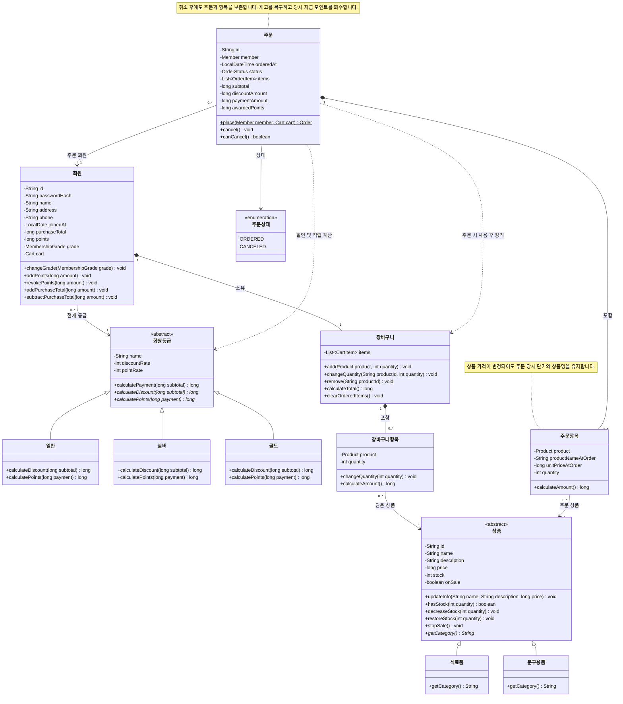

# 쇼핑몰 상품·주문 관리 시스템

2026-2 객체지향프로그래밍[B] 팀 프로젝트

## 1. 프로젝트 개요
- **개발 목적**: 은닉성·상속성·다형성·추상성을 실제 쇼핑몰 업무 규칙(재고, 할인, 결제, 주문 상태)에 적용한 프로그램 개발
- **주요 기능** (계획)
  - 상품 목록 조회 / 검색 (상품 종류: 전자제품·의류·식품)
  - 장바구니 담기, 수량 변경, 삭제
  - 주문: 회원 등급 할인 + 쿠폰 + 배송비 계산 → 결제 → 재고 차감 → 포인트 적립
  - 주문 취소: 재고 복원, 포인트 회수, 환불
  - 관리자: 상품 등록, 배송 처리

## 2. 팀 구성

| 이름 | 학번 | 역할 | 담당 패키지 |
|---|---|---|---|
| 나건희 (팀장) | 2571122 | 상품·장바구니·주문 | `product`, `order`, `service`, `common` |
| 최동근 | 1971099 | 회원·할인·결제·화면 | `member`, `discount`, `payment`, `ui`, `Main` |

### 역할 분담 이유
- 각자 상속·인터페이스·다형성·은닉성을 **모두 한 번씩 다루도록** 기능 단위로 나눔 → 발표 질의응답에서 누구든 OOP 원리를 설명할 수 있게 함
- 예외 처리와 상태 전이가 많은 주문·취소 흐름은 핵심 로직이라 팀장이 담당
- 회원·할인·결제는 같은 패턴(추상 클래스/인터페이스 → 여러 구현체)이 반복되는 구조

### 두 파트가 만나는 메소드 (10주차에 함께 확정)
> 확정 후 시그니처를 바꿔야 하면 PR 설명에 이유를 적고 상대방 확인을 받는다.

| 제공하는 사람 → 쓰는 사람 | 클래스 | 메소드 |
|---|---|---|
| 최동근 → 나건희 | `Member` | (확정 후 작성) |
| 최동근 → 나건희 | `DiscountPolicy` | (확정 후 작성) |
| 최동근 → 나건희 | `PaymentMethod` | (확정 후 작성) |
| 나건희 → 최동근 | `ProductService`, `Cart`, `OrderService`, `Order` | (확정 후 작성) |

### 주차별 계획
| 주차 | 나건희 | 최동근 |
|---|---|---|
| 10 | 시그니처 확정, 빈 클래스 업로드 (공동) | 시그니처 확정, 빈 클래스 업로드 (공동) |
| 10~11 | 상품 클래스, 장바구니 | 회원 클래스, 할인 정책 |
| 11 | 클래스 다이어그램 (공동) | 결제 수단 |
| 12 | 주문·주문 서비스, PR 리뷰 | 콘솔 메뉴 연결 |
| 13 | 통합 테스트·오류 수정 (공동) | 통합 테스트·오류 수정 (공동) |
| 14 | README·발표자료, 상호 설명 연습 (공동) | README·발표자료, 상호 설명 연습 (공동) |

### 협업 규칙
- `main`에 직접 푸시하지 않는다. **브랜치 → PR → 상대방 리뷰 → merge**
  - 브랜치 이름: `feat/기능명` (예: `feat/product`, `feat/discount`), 버그 수정은 `fix/내용`
  - 커밋 메시지: `[기능] 내용` 형식 (예: `[상품] Food 유통기한 할인 추가`)
- 할 일은 **Issues**에 등록하고 담당자 지정, PR에서 `close #이슈번호`로 연결
- 회의 결정 사항은 **Discussions**에 주차별로 기록 (날짜 / 논의 내용 / 결정과 이유 / 다음 할 일)

## 3. 개발 환경
- Java: (작성, 예: JDK 17 이상)
- 개발 도구: (작성, 예: IntelliJ IDEA)
- 외부 라이브러리: 없음

## 4. 프로젝트 폴더 구조
```
OOP_Teamproject/
├─ run.bat / test.bat      컴파일 + 실행 / 테스트 (Windows)
├─ src/shop/
│  ├─ Main.java            프로그램 시작점
│  ├─ common/              공통 인터페이스, 저장소
│  ├─ exception/           쇼핑몰 예외
│  ├─ product/             상품
│  ├─ member/              회원
│  ├─ discount/            할인 정책
│  ├─ payment/             결제 수단
│  ├─ order/               장바구니, 주문
│  ├─ service/             상품·주문 서비스
│  └─ ui/                  콘솔 화면
├─ test/shop/              기능 테스트
└─ docs/                   클래스 다이어그램, 발표자료(PDF)
```
> 개발하면서 구조가 바뀌면 이 표도 함께 수정한다. 빈 폴더의 `.gitkeep`은 폴더를 git에 올리기 위한 빈 파일이라, 코드를 넣은 뒤 지워도 된다.

## 5. 실행 방법
Windows: 폴더의 `run.bat` 더블클릭 (테스트는 `test.bat`)

직접 실행 (macOS/Linux 포함):
```
javac -encoding UTF-8 -d out $(find src -name "*.java")
java -cp out shop.Main
```

## 6. 클래스 다이어그램과 관계 설계

> 손글씨 설계와 팀에서 정리한 관계 목록을 바탕으로 작성한 설계안입니다. 구현 완료를 의미하지 않으며, 코드 변경 시 함께 갱신합니다.
> 이번 설계에서는 상품을 식료품·문구용품으로, 회원등급을 일반·실버·골드로 구분합니다. 다른 절에 남아 있는 전자제품·의류, 쿠폰·결제·배송 관련 내용은 이전 계획이며 이번 다이어그램의 범위에 포함하지 않습니다.

### 6.1 클래스의 역할

| 클래스 | 주요 정보 | 책임 |
|---|---|---|
| 회원(Member) | 회원ID, 비밀번호 해시, 이름, 주소, 전화번호, 가입일, 누적 구매금액, 포인트, 등급 | 회원 정보와 포인트·누적 구매금액 관리 |
| 회원등급(MembershipGrade) | 등급명, 할인율, 적립률 | 공통 혜택 계산 규약과 계산 기능 제공 |
| 일반·실버·골드 | 등급별 혜택 기준 | 등급별 할인·적립 계산 |
| 상품(Product) | 상품ID, 상품명, 설명, 가격, 재고수량, 판매 여부 | 상품 정보와 재고 관리 |
| 식료품·문구용품 | 상품의 공통 정보 | 상품 유형 구분 |
| 장바구니(Cart) | 장바구니항목 목록 | 담기·삭제·수량 변경·합계 계산 |
| 장바구니항목(CartItem) | 상품 참조, 수량 | 현재 상품 가격을 기준으로 항목 금액 계산 |
| 주문(Order) | 주문ID, 회원, 일시, 상태, 상품합계, 할인액, 최종금액, 지급 포인트 | 주문 정보 보존, 주문 확정·취소 |
| 주문항목(OrderItem) | 상품 참조, 주문 당시 상품명·단가, 주문 수량 | 주문 시점의 개별 구매 정보 보존 |

- 기존 메모의 **주문내역** 중 상품ID·수량·단가를 담는 개별 기록은 **주문항목**으로 명명합니다. 주문내역 조회는 주문과 주문항목을 함께 보여주는 기능입니다.
- 가격·재고·수량·포인트는 외부에서 직접 변경하지 않고 검증 메서드로 관리합니다.
- 비밀번호는 원문으로 보관하지 않습니다. 실제 인증 구현 여부는 별도로 정하며, 회원 선택 방식으로 시작할 수도 있습니다.
- 상품 종류별 추가 속성·업무 규칙과 등급별 수치는 구현 전에 확정합니다. 종류 이름만 다르게 두는 상속에 그치지 않도록 검토합니다.

### 6.2 전체 UML 관계 목록

**회원과 등급**

- `회원 "0..*" ────> "1" 회원등급`: 회원은 등급 하나를 참조하며, 같은 등급을 여러 회원이 공유할 수 있습니다.
- `일반 ────▷ 회원등급`: 일반 등급은 회원등급을 상속합니다.
- `실버 ────▷ 회원등급`: 실버 등급은 회원등급을 상속합니다.
- `골드 ────▷ 회원등급`: 골드 등급은 회원등급을 상속합니다.

**장바구니**

- `회원 "1" ◆──── "1" 장바구니`: 회원마다 장바구니 하나를 소유하며, 회원 제거 시 장바구니도 제거합니다.
- `장바구니 "1" ◆──── "0..*" 장바구니항목`: 장바구니는 비어 있거나 여러 항목을 포함합니다.
- `장바구니항목 "0..*" ────> "1" 상품`: 각 항목은 상품 하나를 참조합니다. 상품은 여러 장바구니항목에서 참조될 수 있습니다.

**주문과 주문항목**

- `주문 "0..*" ────> "1" 회원`: 각 주문은 주문한 회원 하나를 참조합니다. 회원은 주문을 0개 이상 가질 수 있습니다. 회원별 주문 조회는 이 연결을 기준으로 수행합니다.
- `주문 "1" ◆──── "1..*" 주문항목`: 확정된 주문은 하나 이상의 주문항목을 소유합니다. 주문 객체 자체를 삭제하면 항목도 함께 제거하지만, **주문 취소는 상태 변경이므로 주문과 항목을 삭제하지 않습니다.**
- `주문항목 "0..*" ────> "1" 상품`: 각 주문항목은 상품 하나를 참조합니다.
- `주문 ────> 주문상태`: 주문 완료·취소 상태를 열거형으로 관리합니다.

**주문 처리 시 사용**

- `주문 ┄┄┄┄> 장바구니`: 주문 확정 시 장바구니를 전달받아 항목을 읽고, 성공 후 주문한 항목을 제거합니다.
- 주문은 이미 연관된 회원의 포인트와 누적 구매금액 변경 메서드를 호출합니다. 따라서 같은 대상을 향한 의존선을 중복해서 그리지 않습니다.
- `주문 ┄┄┄┄> 회원등급`: 주문 시 회원의 등급으로 할인액과 적립 포인트를 계산합니다.

**상품 유형**

- `식료품 ────▷ 상품`: 식료품은 상품을 상속합니다.
- `문구용품 ────▷ 상품`: 문구용품은 상품을 상속합니다.

### 6.3 전체 클래스 다이어그램

속성·메서드명과 자료형은 구현을 위한 초안입니다. 장바구니항목과 주문항목은 서로 상속하지 않고 각각 상품을 참조합니다.



### 6.4 주문·취소 동작 흐름

1. 회원이 상품을 선택하여 장바구니에 담습니다. 같은 상품은 수량을 합치며, 이때 재고를 차감하지 않습니다.
2. 주문 시 장바구니가 비어 있지 않은지, 모든 항목이 판매 중인지, 수량과 재고가 유효한지 먼저 검사합니다. 하나라도 실패하면 재고·포인트·장바구니를 변경하지 않습니다.
3. 회원등급의 메서드로 할인액과 할인 후 금액 기준 적립 포인트를 계산합니다. 금액은 원 단위 정수로 처리하고 소수점 이하는 버립니다.
4. 장바구니항목에서 상품·수량을 읽어 별도의 주문항목을 생성합니다. 당시 상품명·단가와 주문에 적용한 할인액·지급 포인트를 보존합니다.
5. 주문을 확정하고 재고를 차감하며 회원의 포인트와 누적 구매금액을 증가시킵니다. 누적 구매금액은 할인 후 금액을 기준으로 합니다.
6. 주문 성공 후 주문한 장바구니항목을 제거합니다. 실제 결제 연동은 이번 설계에 포함하지 않습니다.
7. 주문내역 조회 시 주문과 그 안의 주문항목을 함께 표시합니다.
8. 취소 시 중복 취소 여부를 검사하고, 재고를 복구하며 해당 주문에서 지급한 포인트와 누적 구매금액을 되돌립니다. 상태만 취소로 변경하고 기록은 남깁니다.

회원 탈퇴의 실제 구현은 별도로 결정합니다. 주문이 회원·상품을 계속 참조하므로 주문 이력이 있는 회원·상품은 기록을 보존하고 비활성화하는 방향으로 설계합니다. 적립금 사용·자동 승급·부분 취소는 이번 설계에서 제외합니다.

### 6.5 관계 기호와 설계 시 주의점

| 표기 | 의미 |
|---|---|
| 실선 + 빈 삼각형 `자식 ────▷ 부모` | 상속: 자식이 부모의 한 종류 |
| 실선 + 채워진 마름모 `전체 ◆──── 부분` | 합성: 부분을 전체가 소유하고 생명주기를 관리 |
| 실선 + 열린 화살표 `A ────> B` | 방향 있는 연관: A가 B를 참조 |
| 점선 + 열린 화살표 `A ┄┄┄┄> B` | 의존: 실행 과정에서 B를 사용 |
| `1`, `0..*`, `1..*` | 각각 하나, 0개 이상, 1개 이상 |

- 관계 끝의 숫자는 반대편 객체 하나에 연결될 수 있는 해당 객체의 개수입니다.
- 주문은 회원을 지속적으로 참조하므로 연관으로 표시합니다. 일시적인 호출이 있다고 같은 두 클래스 사이에 의존선을 추가할 필요는 없습니다.
- 상품 → 장바구니 → 주문은 처리 흐름이며 상속 계층이 아닙니다.
- 현재 설계에서는 주문이 여러 객체와 협력합니다. 구현 중 책임이 과도해지면 주문·취소 조율을 OrderService로 옮기고 다이어그램도 갱신합니다.
- 상속 자체만으로 OOP 적용이 완성되는 것은 아닙니다. 등급별 계산이 실제 주문에 반영되는지, 상품 유형의 차이가 실제 요구사항에 필요한지 검토합니다.

## 7. OOP 적용 내용
| 원리 | 적용 클래스 | 설계 이유 |
|---|---|---|
| 은닉성 | (작성) | (작성) |
| 상속성 | (작성) | (작성) |
| 다형성 | (작성) | (작성) |
| 추상성 | (작성) | (작성) |

## 8. 생성형 AI 활용
- **사용 도구**: Claude (저장소 초기 셋업: 폴더 구조, 실행 스크립트, README 목차, PR 템플릿)
- **활용 수준**: (최종 선택, 0~4단계)
- **주요 활용 내용**: (작성)
- **AI 생성 코드 중 검토·수정한 부분**: (작성)
- **팀에서 직접 결정한 설계**: (작성)

## 9. 기능 테스트 결과
| # | 테스트 내용 | 결과 | 오류 수정 내용 |
|---|---|---|---|
| 1 | (작성) | | |

## 10. 객체지향 설계 개선 내용
| 초기 설계 | 최종 설계 | 변경 이유 |
|---|---|---|
| (작성) | (작성) | (작성) |
