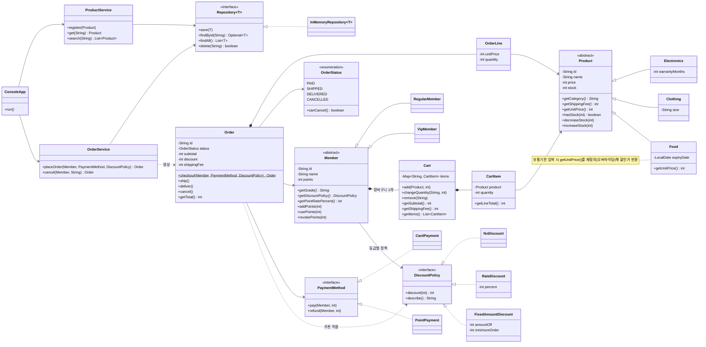
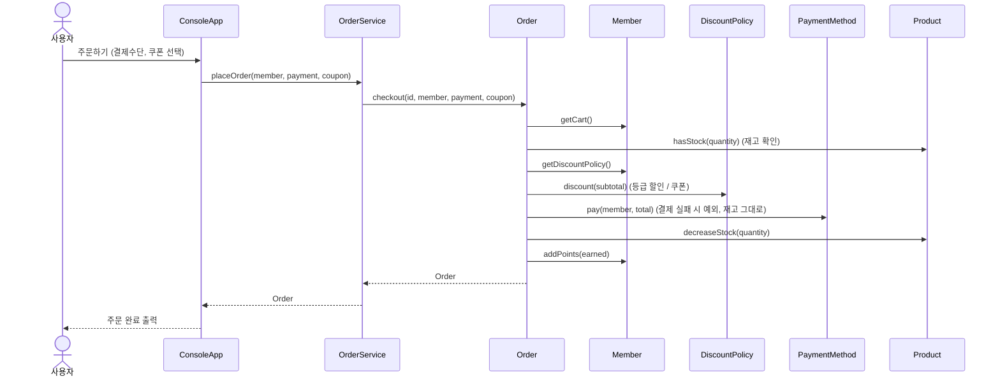

# 쇼핑몰 상품·주문 관리 시스템 (팀 1+1)

2026-2 객체지향프로그래밍[B] 팀 프로젝트

## 1. 프로젝트 개요
- **프로젝트명**: (작성)
- **개발 목적**: 은닉성·상속성·다형성·추상성을 실제 쇼핑몰 업무 규칙(재고, 할인, 결제, 주문 상태)에 적용한 프로그램 개발
- **주요 기능** (계획)
  - 상품 목록 조회 / 검색 (상품 종류: 전자제품·의류·식품)
  - 장바구니 담기, 수량 변경, 삭제
  - 주문: 회원 등급 할인 + 쿠폰 + 배송비 계산 → 결제 → 재고 차감 → 포인트 적립
  - 주문 취소: 재고 복원, 포인트 회수, 환불
  - 관리자: 상품 등록, 배송 처리

## 2. 팀 구성
**팀명: 1+1** — 쇼핑몰의 "1+1 행사"처럼, 두 명이 하나처럼 협력하는 팀

| 이름 | 학번 | 역할 | 담당 패키지 |
|---|---|---|---|
| 나건희 (팀장) | 2571122 | 상품·장바구니·주문 | `product`, `order`, `service`, `common` |
| 최동근 | 1971099 | 회원·할인·결제·화면 | `member`, `discount`, `payment`, `ui`, `Main` |

### 역할 분담 이유
- 각자 상속·인터페이스·다형성·은닉성을 **모두 한 번씩 다루도록** 기능 단위로 나눔 → 발표 질의응답에서 누구든 OOP 원리를 설명할 수 있게 함
- 예외 처리와 상태 전이가 많은 주문·취소 흐름은 핵심 로직이라 팀장이 담당
- 회원·할인·결제는 같은 패턴(추상 클래스/인터페이스 → 여러 구현체)이 반복되는 구조

### 두 파트가 만나는 메소드 (10주차에 함께 확정)
> 확정 후 시그니처를 바꿔야 하면 PR 설명에 이유를 적고 상대방 확인을 받는다.

| 제공하는 사람 → 쓰는 사람 | 클래스 | 메소드 |
|---|---|---|
| 최동근 → 나건희 | `Member` | (확정 후 작성) |
| 최동근 → 나건희 | `DiscountPolicy` | (확정 후 작성) |
| 최동근 → 나건희 | `PaymentMethod` | (확정 후 작성) |
| 나건희 → 최동근 | `ProductService`, `Cart`, `OrderService`, `Order` | (확정 후 작성) |

### 주차별 계획
| 주차 | 나건희 | 최동근 |
|---|---|---|
| 10 | 시그니처 확정, 빈 클래스 업로드 (공동) | 시그니처 확정, 빈 클래스 업로드 (공동) |
| 10~11 | 상품 클래스, 장바구니 | 회원 클래스, 할인 정책 |
| 11 | 클래스 다이어그램 (공동) | 결제 수단 |
| 12 | 주문·주문 서비스, PR 리뷰 | 콘솔 메뉴 연결 |
| 13 | 통합 테스트·오류 수정 (공동) | 통합 테스트·오류 수정 (공동) |
| 14 | README·발표자료, 상호 설명 연습 (공동) | README·발표자료, 상호 설명 연습 (공동) |

### 협업 규칙
- `main`에 직접 푸시하지 않는다. **브랜치 → PR → 상대방 리뷰 → merge**
  - 브랜치 이름: `feat/기능명` (예: `feat/product`, `feat/discount`), 버그 수정은 `fix/내용`
  - 커밋 메시지: `[기능] 내용` 형식 (예: `[상품] Food 유통기한 할인 추가`)
- 할 일은 **Issues**에 등록하고 담당자 지정, PR에서 `close #이슈번호`로 연결
- 회의 결정 사항은 **Discussions**에 주차별로 기록 (날짜 / 논의 내용 / 결정과 이유 / 다음 할 일)

## 3. 개발 환경
- Java: (작성, 예: JDK 17 이상)
- 개발 도구: (작성, 예: IntelliJ IDEA)
- 외부 라이브러리: 없음

## 4. 프로젝트 폴더 구조
```
OOP_Teamproject/
├─ run.bat / test.bat      컴파일 + 실행 / 테스트 (Windows)
├─ src/shop/
│  ├─ Main.java            프로그램 시작점
│  ├─ common/              공통 인터페이스, 저장소
│  ├─ exception/           쇼핑몰 예외
│  ├─ product/             상품
│  ├─ member/              회원
│  ├─ discount/            할인 정책
│  ├─ payment/             결제 수단
│  ├─ order/               장바구니, 주문
│  ├─ service/             상품·주문 서비스
│  └─ ui/                  콘솔 화면
├─ test/shop/              기능 테스트
└─ docs/                   클래스 다이어그램, 발표자료(PDF)
```
> 개발하면서 구조가 바뀌면 이 표도 함께 수정한다. 빈 폴더의 `.gitkeep`은 폴더를 git에 올리기 위한 빈 파일이라, 코드를 넣은 뒤 지워도 된다.

## 5. 실행 방법
Windows: 폴더의 `run.bat` 더블클릭 (테스트는 `test.bat`)

직접 실행 (macOS/Linux 포함):
```
javac -encoding UTF-8 -d out $(find src -name "*.java")
java -cp out shop.Main
```

## 6. 클래스 다이어그램
> **초기 설계안**이다. 구현하면서 클래스·메소드가 바뀌면 이 그림도 함께 고치고, 바뀐 이유는 10번에 적는다.
> 나건희 담당: `Product`·`Cart`·`Order`·`Service`·`Repository` / 최동근 담당: `Member`·`DiscountPolicy`·`PaymentMethod`·`ConsoleApp`



**관계 읽는 법**: `◁──` 상속(extends), `◁┄┄` 구현(implements), `◆──` 구성(부분이 전체에 속함, 예: 장바구니는 회원에 속함), `──▶` 연관(참조), `┄┄▶` 의존(메소드 안에서 사용)

### 주문 실행 흐름 (`placeOrder`)



> 결제(`pay`)를 재고 차감보다 **먼저** 하는 이유: 결제가 실패해도 재고와 장바구니가 그대로 남게 하기 위해서다.

## 7. OOP 적용 내용
| 원리 | 적용 클래스 | 설계 이유 |
|---|---|---|
| 은닉성 | (작성) | (작성) |
| 상속성 | (작성) | (작성) |
| 다형성 | (작성) | (작성) |
| 추상성 | (작성) | (작성) |

## 8. 생성형 AI 활용
- **사용 도구**: Claude (저장소 초기 셋업: 폴더 구조, 실행 스크립트, README 목차, PR 템플릿)
- **활용 수준**: (최종 선택, 0~4단계)
- **주요 활용 내용**: (작성)
- **AI 생성 코드 중 검토·수정한 부분**: (작성)
- **팀에서 직접 결정한 설계**: (작성)

## 9. 기능 테스트 결과
| # | 테스트 내용 | 결과 | 오류 수정 내용 |
|---|---|---|---|
| 1 | (작성) | | |

## 10. 객체지향 설계 개선 내용
| 초기 설계 | 최종 설계 | 변경 이유 |
|---|---|---|
| (작성) | (작성) | (작성) |
