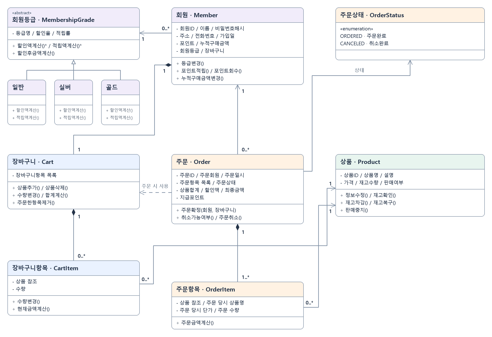

# 쇼핑몰 상품·주문 관리 시스템

상품을 장바구니에 담아 주문하고 취소할 수 있는 쇼핑몰 프로그램입니다. 회원 등급별 할인과 포인트 적립을 추가하고, 객체지향 원리를 활용하여 상품·회원·주문이 협력하도록 구현할 예정입니다.

## 프로젝트 현황

- **팀원:** 나건희(팀장, 2571122), 최동근(1971099)
- **개발 계획:** Java 기반 콘솔 프로그램. JDK 버전·개발 도구는 확정 후 반영합니다.
- **현재 단계:** 기능과 클래스 관계 설계 정리 완료, 코딩 시작 전
- **저장소:** [GitHub 프로젝트](https://github.com/nageonhee/OOP_Teamproject)

## 주요 기능

| 기능 | 내용 |
|---|---|
| 상품 관리 | 상품 등록·조회·수정, 재고 관리, 판매 중지 |
| 장바구니 | 상품 담기·삭제·수량 변경, 합계 조회 |
| 주문 | 재고·판매 상태 확인, 할인 적용, 주문 기록 생성, 재고 차감 |
| 주문 내역·취소 | 구매 내역 확인, 전체 취소, 재고 복구와 지급 포인트 회수 |
| 회원 등급 | 일반·실버·골드별 할인·포인트 적립 및 조회 |

**이용 흐름:** 회원 선택 → 상품 조회 → 장바구니 → 주문 → 내역 조회·취소

실제 결제 연동·부분 취소·포인트 사용·자동 승급은 현재 범위에서 제외합니다. 등급별 할인율·적립률은 확정 예정입니다.

## 클래스 다이어그램

## 객체지향 적용 방향

| 원리 | 적용 계획 |
|---|---|
| 은닉성 | 재고·수량·포인트를 보호하고 검증 메서드로 변경 |
| 상속성 | 일반·실버·골드가 회원등급의 공통 정보와 기능을 상속 |
| 다형성 | 공통 회원등급 타입으로 등급별 할인·적립 계산 |
| 추상성 | 추상 회원등급 클래스에서 혜택 계산 규약 정의 |

클래스별 책임과 관계를 정한 구체적인 이유는 [README](https://github.com/nageonhee/OOP_Teamproject#6-클래스-다이어그램과-관계-설계)에 정리합니다.

## 역할과 개발 계획

| 담당 | 중심 영역 |
|---|---|
| 나건희 | 상품·장바구니·주문 |
| 최동근 | 회원·등급 혜택·화면 |
| 공동 | 규약 합의, 통합 검증, 문서·발표 준비 |

| 기간 | 목표 |
|---|---|
| 12주차 | 설계 검토, 환경 확정, 기본 클래스·상품·장바구니 구현 |
| 13주차 | 주문·취소·등급 혜택 연결 |
| 14주차 | 예외 상황 검증, 오류 수정, 발표자료·시연 준비 |
| 15주차 | 소스코드·README·발표 PDF 제출 및 발표 |

재고 부족 주문, 등급별 혜택 차이, 주문 당시 가격 보존, 취소 시 복구, 중복 취소 방지를 중심으로 동작을 검증할 예정입니다.

## AI 활용

**활용 수준: 1단계.** 기능 선정과 클래스 구성·관계 설계는 팀에서 직접 수행했습니다. AI는 개념 설명·검토 의견·팀이 설계한 다이어그램의 시각화·문서 정리에 활용했으며, Claude는 저장소 초기 구성에 활용했습니다. 코딩은 팀에서 직접 진행할 예정입니다.
